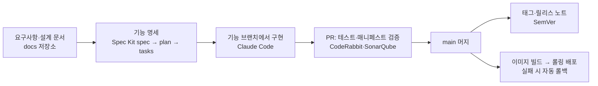

<picture>
  <source media="(prefers-color-scheme: dark)" srcset="https://raw.githubusercontent.com/AIGJ-01-002-blog/devlog/main/assets/images/logo-dark.png" />
  
</picture>

# AIGJ-01-002 · devlog 팀

**블로그를 만들면서 무엇을 고민했고, 왜 그렇게 골랐는지 기록합니다.**

[devlog 저장소](https://github.com/AIGJ-01-002-blog/devlog) · [설계 문서](https://github.com/AIGJ-01-002-blog/docs) · [변경 기록](https://github.com/AIGJ-01-002-blog/devlog/blob/main/CHANGELOG.md) · [devlog.life](https://devlog.life)

> 기능 소개는 [devlog README](https://github.com/AIGJ-01-002-blog/devlog#readme)에 있습니다. 이 페이지는 "무엇을 만들었나"보다 **어떤 문제를 만났고, 어떤 기술을 왜 골랐고, 어떤 과정으로 만들었는지**를 적습니다.

## 풀려던 문제

개발자는 AI와 코딩하면서 하루에도 여러 번 문제를 풀지만, 그 과정을 글로 남기는 일은 미루기 쉽습니다. 그래서 **AI가 개발 일지 초안을 쓰고, 사람은 읽고 고쳐서 발행하는 블로그**를 목표로 잡았습니다. Velog처럼 Markdown으로 쓰는 개발 블로그를 기본으로 두고, 그 위에 Claude·ChatGPT에서 바로 글을 쓰는 MCP 연결을 더했습니다.

## 고른 기술과 이유

| 고민 | 고른 것 | 이유 | 대신 생각했던 것 |
| --- | --- | --- | --- |
| 서버를 몇 개로 나눌까 | 모듈러 모놀리스(Spring Boot 앱 하나) | 세 명이 짧은 기간에 만들기에 서비스를 쪼개면 배포·통신 비용이 더 큼. 기능은 패키지 모듈로 나누고 도메인 사건으로 느슨하게 이음 | 마이크로서비스 |
| 본문을 어떻게 안전하게 보여 줄까 | 서버에서 Markdown → HTML 렌더링 후 OWASP Sanitizer로 허용 목록 정화 | 브라우저에만 맡기면 API로 직접 넣은 글이 XSS가 됨. 정화 결과를 서버가 한 번 만들어 캐시 | 브라우저에서 렌더링 |
| 파드가 여러 개일 때 로그인을 어떻게 유지할까 | Redis 세션 | 어느 파드로 가도 같은 사용자. 같은 Redis로 요청 횟수 제한·조회수 모으기도 처리 | 스티키 세션, JWT |
| 사진을 어디에 둘까 | MinIO(S3 호환), 브라우저에서 WebP로 줄여서 올림 | 앱 디스크에 두면 파드끼리 공유가 안 됨. 변환은 브라우저가, 검증은 서버가 맡아 서버 부담을 줄임 | 앱 서버 디스크 |
| 끊김 없이 배포하고 실패하면 되돌리려면 | 쿠버네티스 롤링 배포 + readiness 검사 + 자동 롤백 | 새 파드가 준비되기 전에는 옛 파드를 내리지 않음. 300초 안에 준비 안 되면 직전 버전으로 | 서버에서 jar 교체 |
| 학교 서버를 밖에서 어떻게 열까 | Cloudflare Tunnel | 서버 포트를 열 수 없는 환경이라, 서버 안에서 바깥으로 연결을 맺음 | 포트 포워딩 |
| AI 비용을 어떻게 줄일까 | 자체 Ollama 먼저, Gemini 무료 등급은 상한 안에서만, 결과 재사용 | AI가 꼭 필요한 곳(태그 추천·메모 다듬기·뜻 검색)에만 쓰고, 꺼져도 글쓰기와 키워드 검색은 그대로 | 유료 API 상시 호출 |

## 만든 과정

- **명세 먼저**: 기능마다 GitHub Spec Kit으로 spec → plan → tasks를 쓰고 구현했습니다. 지금 89개 기능 명세가 있습니다.
- **AI와 함께 개발**: Claude Projects에서 작업마다 스레드를 열고, Claude Code가 기능 브랜치에서 코드를 쓰고 테스트를 돌려 PR을 엽니다. 사람은 무엇을 만들지와 규칙(버전, 비밀값, UX 확인, 되돌리기 어려운 일은 하지 않기)을 정하고, 매일 아침 보고로 결정합니다.
- **검사로 지키는 규칙**: 백엔드 줄 커버리지 40% 미만, 타입 오류, 비밀값 커밋, README와 실제 버전 불일치는 CI가 막습니다.
- **버전**: Semantic Versioning. CHANGELOG 맨 위 버전이 main에 들어가면 태그와 릴리스가 자동으로 만들어집니다. 문서만 바꾸면 버전도 배포도 없습니다.

## 지금 다시 고민하는 것

2026-10-12 중간 점검에서 받은 피드백으로, 아래를 다음 목표로 잡았습니다.

- **오버 엔지니어링**: 사용자 수에 비해 쿠버네티스·파드 여러 개·MinIO·임베딩 서버는 무겁습니다. 그 상당수가 "파드를 여러 개 띄운다"는 첫 선택에서 따라 나왔습니다. 가벼운 구성(앱 1개 + PostgreSQL + Redis)과 메모리·응답 시간을 재서 비교합니다.
- **브랜치 전략**: 지금은 기능 브랜치를 main에 바로 머지해 바로 배포합니다. 버전마다 목표를 정하고 feature → develop(시험 환경) → release → main으로 가는 Git Flow를 검토합니다.
- **배포가 테스트를 기다리게**: main에서 배포 워크플로가 테스트 워크플로와 동시에 시작합니다. 같은 커밋의 테스트가 통과한 뒤에만 배포하도록 바꿉니다.
- **릴리스 노트**: 글로만 적던 노트에 바뀐 화면의 전/후 사진과 PR·브랜치 정보를 더합니다.

## 저장소

| 저장소 | 내용 |
| --- | --- |
| [devlog](https://github.com/AIGJ-01-002-blog/devlog) | 코드: Spring Boot 4.1·Java 21 백엔드, React 19 화면, 쿠버네티스 배포, CI/CD, 기능 명세 |
| [docs](https://github.com/AIGJ-01-002-blog/docs) | 설계 문서: 공통 요구사항, 아키텍처, ERD, 기능별 설계, 권한 표 |

코드와 문서 저장소를 나눈 이유는 문서만 고칠 때 배포가 돌지 않게 하려는 것입니다.
